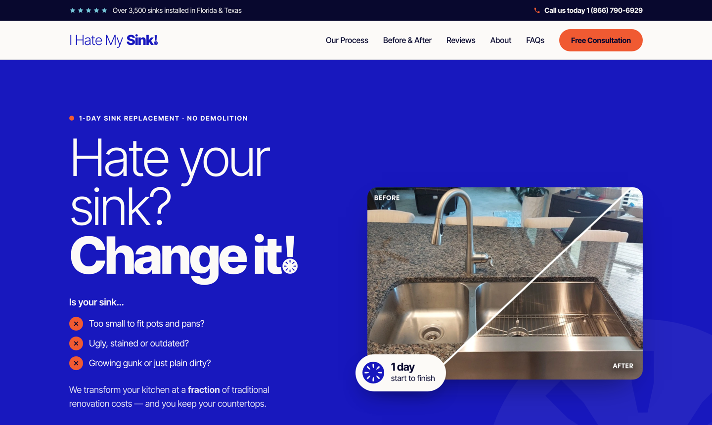

# I Hate My Sink! — rebrand prototype

**Live site: https://vxzvic.github.io/ihatemysink-rebrand/**

Static prototype of the ihatemysink.com homepage in the new brand identity
(Signal Blue, Mineral Blue, Signal Orange, Porcelain, Midnight Blue; light/bold wordmark with the drain-mark "!").

- `index.html`: homepage
- `assets/styles.css`: brand tokens and layout
- `assets/main.js`: before/after sliders, review carousel, mobile menu, form validation
- `assets/drain-mark.svg`: the drain mark as a standalone SVG

**Rebranding the real Webflow site? Follow [WEBFLOW-GUIDE.md](WEBFLOW-GUIDE.md).** Logos, icons and the code snippet are in `brand-kit/`.

To run it locally, open `index.html` in a browser. The live site updates automatically through GitHub Pages whenever `main` changes.

Notes: the typeface is Inter Tight, standing in for the licensed guideline face. The forms are not yet connected to a backend.
The page is marked `noindex` so the prototype stays out of search results.
